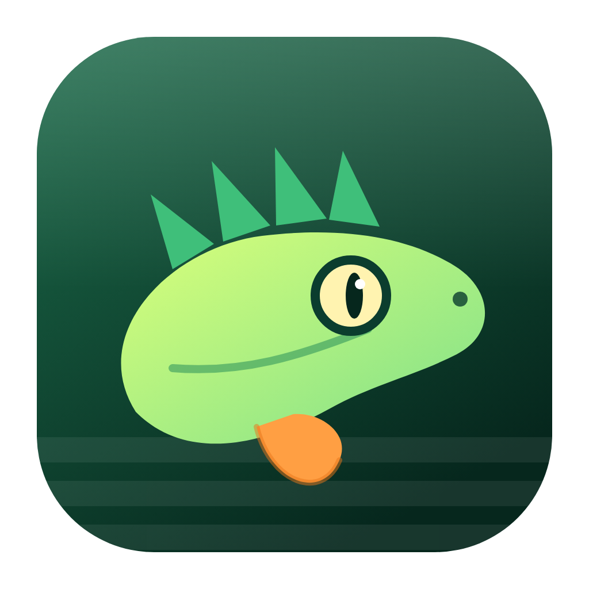
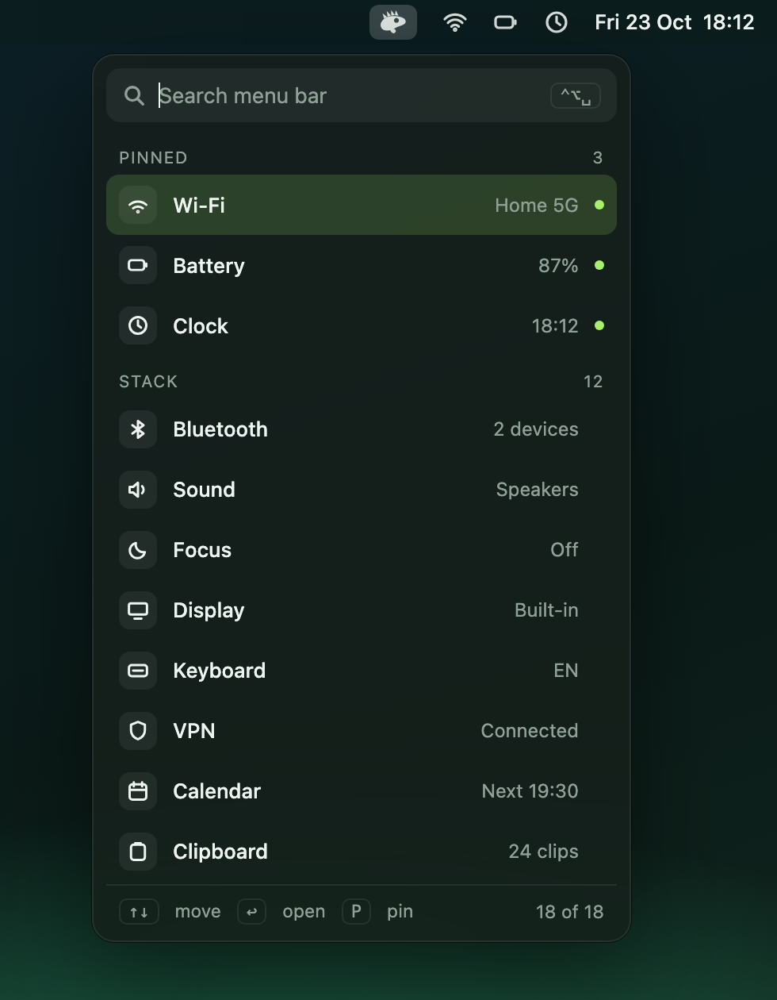
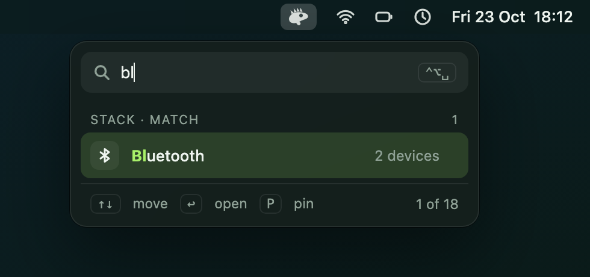

<p align="center">
  
</p>

<h1 align="center">Iguana</h1>
<p align="center">A quiet home for your menu bar. One icon, one stacked list, instant search.</p>

<p align="center">
  
  &nbsp;
  
</p>

> **Status: v0.1 built.** The landing page is [`docs/index.html`](docs/index.html); the design mockup is [`docs/mockup.html`](docs/mockup.html).

## Install

```sh
git clone <this repo> && cd iguana
scripts/bundle.sh          # builds dist/Iguana.app (about 1.3 MB)
open dist/Iguana.app
```

On first launch, allow **Accessibility** (System Settings → Privacy & Security). Iguana uses it to read and open menu bar items, nothing else.

## What it is

Iguana is a featherweight macOS menu bar organiser. Instead of fighting for space in the bar, your items move into a single vertical **stack** under one small icon.

- **Stacked list**: Pinned, In the bar, Tucked away. One column, no second bar.
- **Noise-free search**: `⌃⌥␣`, type, `↩`. Matches highlight, the rest vanishes.
- **Automatic tidy**: if icons are crowding your bar, the popover offers one **Tidy up** button. Iguana switches them off for you in System Settings → Menu Bar (the same switches macOS gives you), so tucked-away items are really gone from the bar. They stay in the list; clicking one brings it back and opens it. Pin an item to keep it in the bar. Hover a row for the pin and tuck-away buttons, or use ⌘P and ⌘Delete.
- **Brief flash**: Settings opens out of sight for about a second while Iguana flips the switches.
- **Live stats strip**: CPU, RAM, GPU and GPU memory, sampled once a second while the popover is open and not at all when it is closed. `⌘M` toggles it.
- **Pinning**: `⌘P` keeps an item at the top and in the bar.
- **Keyboard first**: `↑↓` move, `↩` open, `Esc` close.
- **Native look**: translucent material, system font, automatic light and dark.
- **Private**: no account, no network, no analytics.

## Superlight (measured, v0.1)

| | |
|---|---|
| App size | 1.3 MB |
| Memory footprint, idle | about 9 MB |
| Idle CPU | 0%, event driven |
| Dependencies | none |

Native Swift (SwiftUI + AppKit). No web view. No timers while the panel is closed.

## Icon

An iguana in profile: a crest of four spikes, a slit-pupil eye, an orange dewlap resting on stacked rows. The menu bar uses a one-colour template version, [`docs/assets/glyph.svg`](docs/assets/glyph.svg). Source: [`docs/assets/icon.svg`](docs/assets/icon.svg).

## Repo layout

```
Sources/IguanaKit/   matching, grouping, naming (unit tested)
Sources/Iguana/      menu bar app: scanner, popover, icon
scripts/bundle.sh    builds the .app
docs/                GitHub Pages site
  index.html         landing page
  mockup.html        interactive mockup
  assets/            icon, glyph, screenshots
README.md
```

## Pages

Enable GitHub Pages with source `main` / `/docs`.
